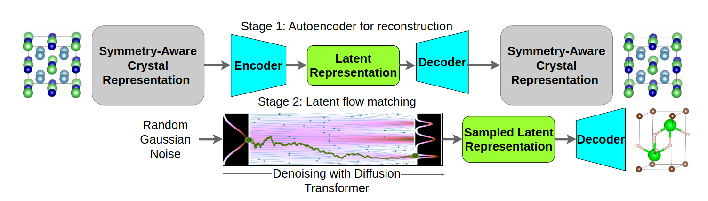

# SymADiT



This repository contains the official implementation of the NeurIPS 2026 paper **[SymADiT: Symmetry-Aware Crystal Generation with Latent Flow Matching](https://arxiv.org/abs/2605.10115)** by Anmar Karmush, Cedric Mathieu Brandenburg, Soheil Ershadrad, Johanna Rosen, Michael Felsberg, and Filip Ekström Kelvinius.


## Data


More information will come.


## Installation

More information will come.


## Scripts

Training is performed in two stages. **Train the autoencoder first**, then use its checkpoint to train the latent flow-matching model.

**Stage 1 — Autoencoder:**

```bash
./scripts/interactive_scripts/ae.sh
```

**Stage 2 — Latent flow matching (DiT):**

```bash
./scripts/interactive_scripts/ldm.sh
```

**To generate crystals:**
```bash
./scripts/interactive_scripts/generation.sh
```

**To evaluate crystals:**
```bash
./scripts/interactive_scripts/evaluation.sh
```


## Questions and issues

If you have questions or encounter an issue, please open an issue in this repository or email [me](anmar.karmush@liu.se).

## Citation

If you use this code, please cite the SymADiT paper:

```bibtex
@inproceedings{karmush2026symadit,
  title     = {SymADiT: Symmetry-Aware Crystal Generation with Latent Flow Matching},
  author    = {Karmush, Anmar and Brandenburg, Cedric Mathieu and Ershadrad, Soheil and Rosen, Johanna and Felsberg, Michael and Ekstr{"o}m Kelvinius, Filip},
  booktitle = {Advances in Neural Information Processing Systems},
  year      = {2026}
}
```

## License

This codebase is heavily based on the [All-atom Diffusion Transformer (ADiT)](https://github.com/facebookresearch/all-atom-diffusion-transformer) implementation, which is released under the MIT License. We acknowledge the original authors for making their code publicly available.
