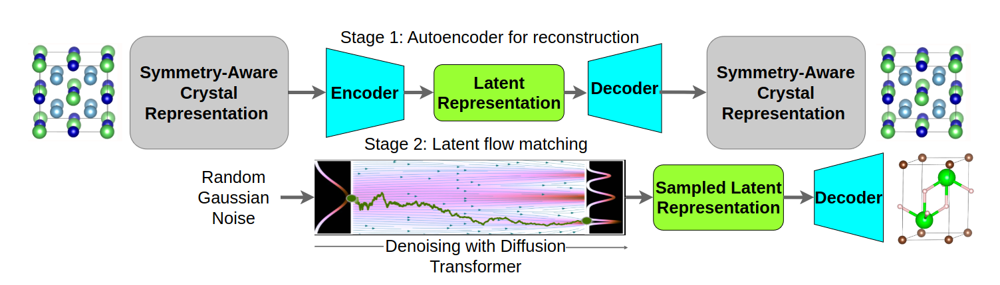

# SymADiT



This repository contains the official implementation of the NeurIPS 2026 paper **[SymADiT: Symmetry-Aware Crystal Generation with Latent Flow Matching](https://arxiv.org/abs/2605.10115)** by Anmar Karmush, Cedric Mathieu Brandenburg, Soheil Ershadrad, Johanna Rosen, Michael Felsberg, and Filip Ekström Kelvinius.


## Data and Preprocessing


The three datasets used in the paper are provided in the `data/` directory. Each dataset has its own subdirectory containing a CSV file with the raw crystal structures. The preprocessing pipeline can be used to convert these CSV files into `.pt` files required for training.

Each dataset directory also contains precomputed histograms of space group frequencies and the distribution of the number of atomic orbits conditioned on the space group. These statistics are used during the generation process.

Additionally, the `data/symmetry/` directory contains the Wyckoff symmetry information used to construct symmetry-aware crystal representations.


## Installation

More information will come.

## Checkpoints

Checkpoints are on the way! 

## Scripts

The pipeline consists of four stages: autoencoder training, latent flow-matching training, crystal generation, and evaluation. First, the autoencoder is trained to learn a symmetry-aware latent representation of crystal structures. Its checkpoint is then used to train a latent flow-matching model (DiT). Once trained, the model can generate new crystal structures, which can subsequently be evaluated using the provided evaluation pipeline.


**Stage 1 — Autoencoder:**

```bash
./scripts/interactive_scripts/ae.sh
```

**Stage 2 — Latent flow matching (DiT):**

```bash
./scripts/interactive_scripts/ldm.sh
```

**To generate crystals:**
```bash
./scripts/interactive_scripts/generation.sh
```

**To evaluate crystals:**
```bash
./scripts/interactive_scripts/evaluation.sh
```


## Questions and issues

If you have questions or encounter an issue, please open an issue in this repository or email [me](anmar.karmush@liu.se).

## Citation

If you use this code, please cite the SymADiT paper:

```bibtex
@inproceedings{karmush2026symadit,
  title     = {SymADiT: Symmetry-Aware Crystal Generation with Latent Flow Matching},
  author    = {Karmush, Anmar and Brandenburg, Cedric Mathieu and Ershadrad, Soheil and Rosen, Johanna and Felsberg, Michael and Ekstr{"o}m Kelvinius, Filip},
  booktitle = {Advances in Neural Information Processing Systems},
  year      = {2026}
}
```

## License

This codebase is heavily based on the [All-atom Diffusion Transformer (ADiT)](https://github.com/facebookresearch/all-atom-diffusion-transformer) implementation, which is released under the MIT License. We acknowledge the original authors for making their code publicly available.
